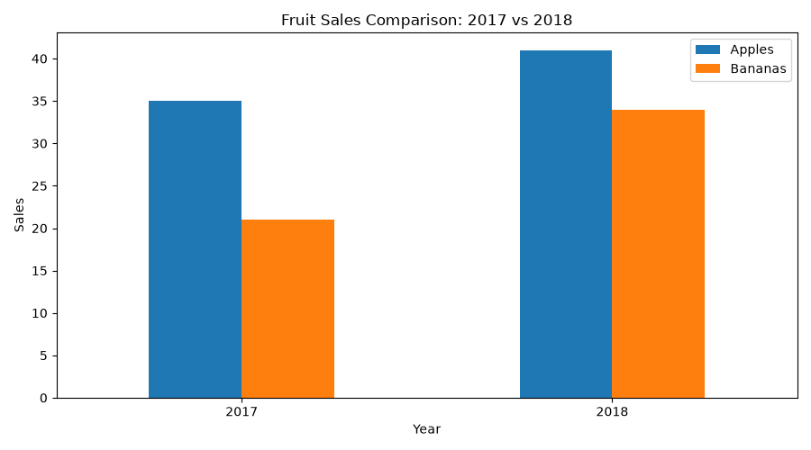
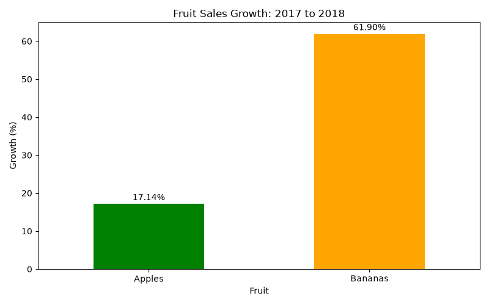

# Fruit Sales Data Analysis

A Python data-analysis project that uses **pandas** and **Matplotlib** to analyze fruit sales data, calculate sales growth, and generate visualizations.

## Project Overview

This project analyzes apple and banana sales from 2017 and 2018. It demonstrates CSV file generation, DataFrame manipulation, data aggregation, percentage calculations, and data visualization.

## Features

- Create and export sales data to CSV using pandas.
- Calculate yearly sales totals.
- Calculate total sales for each fruit.
- Calculate percentage growth between 2017 and 2018.
- Generate and save sales comparison and growth charts.

## Technologies Used

- Python
- pandas
- Matplotlib
- CSV
- Git and GitHub

## Sales Data

| Year | Apples | Bananas |
|---|---:|---:|
| 2017 | 35 | 21 |
| 2018 | 41 | 34 |

## Analysis Results

| Metric | Apples | Bananas |
|---|---:|---:|
| Total sales | 76 | 55 |
| Growth (2017–2018) | 17.14% | 61.90% |

Total sales increased from **56 in 2017** to **75 in 2018**.

Bananas experienced a higher growth rate, while apples had higher total sales.

## Data Visualizations

### Fruit Sales Comparison



### Fruit Sales Growth



## How to Run

Install the required Python packages:

```bash
python -m pip install pandas matplotlib
```

Run the analysis:

```bash
python analysis.py
```

The script generates `fruit.csv`, `fruit-sales-comparison.png`, and `fruit-sales-growth.png`.

## Skills Demonstrated

Python programming, pandas DataFrames, data aggregation, CSV processing, percentage growth calculations, Matplotlib visualization, and GitHub project documentation.